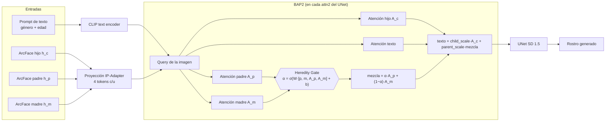
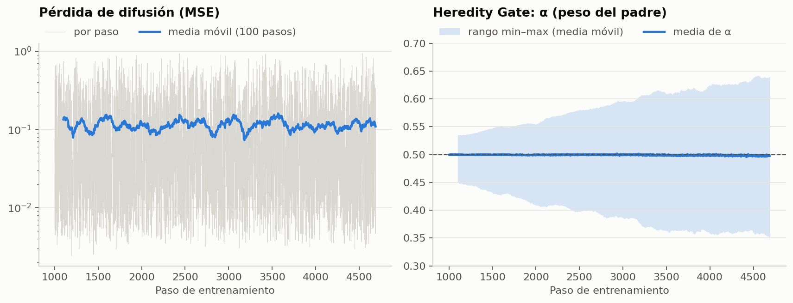
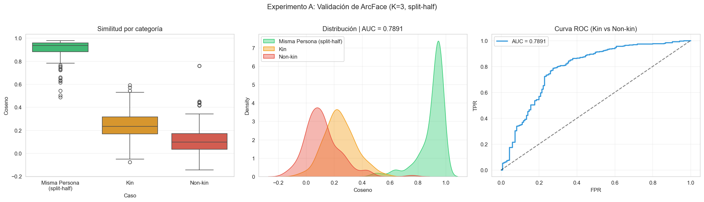

# BAP2: generación de rostros de hijos a partir de sus padres

**Atención biparental con *Heredity Gate* sobre Stable Diffusion + IP-Adapter-FaceID**

Trabajo Terminal II · Ingeniería en Inteligencia Artificial


> **English summary.** BAP2 is a custom cross-attention processor for Stable Diffusion 1.5 that conditions
> face generation on **three identities at once** (child, father, mother). It extends IP-Adapter-FaceID with
> separate father/mother attention branches whose outputs are blended by a learned, channel-grouped
> **Heredity Gate** (α = how much each parent contributes). Only the gate is trained (≈0.79 M parameters,
> diffusion MSE loss) on 1,563 parent–child triads from the *Families in the Wild* (FIW) dataset. The repo
> contains the full pipeline: dataset analysis and family-level splits, ArcFace embedding validation
> (kin vs. non-kin AUC = 0.79), age labeling with MiVOLO, training, and evaluation with FID, age error
> and identity/kinship similarity, plus CPU unit tests.

---

## Contenido

- [Motivación](#motivación)
- [Arquitectura](#arquitectura)
- [Pipeline del proyecto](#pipeline-del-proyecto)
- [Resultados](#resultados)
- [Estructura del repositorio](#estructura-del-repositorio)
- [Instalación y uso](#instalación-y-uso)
- [Pruebas](#pruebas)
- [Limitaciones y trabajo futuro](#limitaciones-y-trabajo-futuro)
- [Consideraciones éticas](#consideraciones-éticas)
- [Referencias](#referencias)

## Motivación

Los modelos de difusión con adaptadores de identidad (como IP-Adapter-FaceID) pueden generar retratos que
conservan la identidad de **una** persona a partir de su embedding facial. Este proyecto explora cómo
condicionar la generación con **la identidad de ambos padres** al mismo tiempo, de forma que el rostro
generado del hijo conserve rasgos familiares, y cómo aprender cuánto contribuye cada padre en lugar de
fijarlo a mano.

## Arquitectura

BAP2 (*Biparental Attention Processor v2*, "Child-Anchor BAP con Heredity Gate contextual") reemplaza los
16 procesadores de atención cruzada (`attn2`) del UNet de Stable Diffusion 1.5. La autoatención (`attn1`)
queda intacta.



**Ecuación por capa:**

```
α          = sigmoid( W · [mean(tokens_p), mean(tokens_m), mean(A_p), mean(A_m)] + b )   # [B, 16 grupos]
parent_mix = α · A_p + (1 − α) · A_m
salida     = Atención_texto + scale · ( child_scale · A_c + parent_scale · parent_mix )
```

Decisiones de diseño clave:

| Decisión | Motivo |
|---|---|
| Ramas padre/madre inicializadas con los pesos `to_k_ip` / `to_v_ip` de IP-Adapter-FaceID | Partir de una proyección que ya sabe traducir embeddings ArcFace a atención facial. |
| Gate inicializado en cero → α = 0.5 | Al inicio el modelo mezcla ambos padres por igual; el entrenamiento solo se aparta de ahí si reduce la pérdida. |
| α por **grupos de canales** (16 grupos) | Permite que distintas partes de la representación hereden de distinto padre. |
| Gate en `float32`, ramas en `float16` | El gate en `fp16` producía NaN; el resto conserva la eficiencia de media precisión. |
| *Child anchor* (`child_scale = 1.0`, `parent_scale = 0.1`) | El hijo fija la identidad base; los padres aportan una señal de parentesco controlable. |
| Solo se entrena el gate (≈ 0.79 M parámetros) | El UNet, VAE, codificador de texto y proyección de IP-Adapter se congelan. |

Implementación: [`src/bap2.py`](src/bap2.py) (procesador) y [`src/att2.py`](src/att2.py) (instalación en el UNet).

## Pipeline del proyecto

| # | Notebook | Qué hace |
|---|---|---|
| 01 | [`01_database_exploration`](notebooks/01_database_exploration.ipynb) | Análisis de FIW (980 familias), extracción de tríadas padre–madre–hijo y división **por familia** 80/10/10 para evitar fugas de identidad. |
| 02 | [`02_arcface_validation`](notebooks/02_arcface_validation.ipynb) | Extracción de embeddings ArcFace (InsightFace `buffalo_l`) y validación: misma persona vs. parientes vs. no parientes, similitud por tipo de relación. |
| 03 | [`03_mivolo_age_estimation`](notebooks/03_mivolo_age_estimation.ipynb) | Etiquetado de edad de los 1,967 hijos con MiVOLO v2 (la edad entra al prompt). |
| 04 | [`04_entrenamiento_bap2`](notebooks/04_entrenamiento_bap2.ipynb) | Primeras fases de entrenamiento del gate (pasos 0 → 1000), auditoría visual, barrido de `parent_scale` y comparación contra la línea base sin gate. |
| 05 | [`05_entrenamiento_final_bap2`](notebooks/05_entrenamiento_final_bap2.ipynb) | Entrenamiento final (pasos 1000 → 4689, 3 épocas), selección de checkpoint y prueba final sobre 208 tríadas × 5 edades. |
| 06 | [`06_metricas_fid_edad`](notebooks/06_metricas_fid_edad.ipynb) | Métricas finales: FID, error de edad (E_age) y similitud de identidad/parentesco con estadística pareada. |
| 07 | [`07_figuras_cualitativas`](notebooks/07_figuras_cualitativas.ipynb) | Figuras cualitativas por método y progresión de edad. |
| 08 | [`08_figuras_finales_child`](notebooks/08_figuras_finales_child.ipynb) | Figuras finales con prompts infantiles para la tesis. |

> Los notebooks 04, 05, 07 y 08 se publican **sin las imágenes de salida**, porque contenían rostros reales
> de FIW y rostros generados a partir de ellos. El código y los registros de texto están completos.

### Datos

- **Dataset:** [Families in the Wild (FIW)](https://web.northeastern.edu/smilelab/fiw/) — 980 familias, ~26.5 k rostros.
- **Tríadas:** 1,571 (train) / 196 (val) / 212 (test) tríadas únicas padre–madre–hijo; 1,563 / 208 en uso tras filtrar embeddings faltantes.
- **División:** por familia (630 / 79 / 79 familias), ninguna familia aparece en dos particiones.

Ver [`data/README.md`](data/README.md) para reconstruir los datos.

### Entrenamiento

| Parámetro | Valor |
|---|---|
| Modelo base | `SG161222/Realistic_Vision_V4.0_noVAE` + VAE `stabilityai/sd-vae-ft-mse` |
| Adaptador | IP-Adapter-FaceID SD 1.5 (`h94/IP-Adapter-FaceID`) |
| Pérdida | MSE de predicción de ruido (L_diff) |
| Optimizador | AdamW, lr = 1e-4, eps = 1e-6, weight decay = 0, clip grad = 1.0 |
| Batch / pasos | 1 / 4,689 (3 épocas sobre 1,563 tríadas) |
| Parámetros entrenables | 792,832 (solo los 16 Heredity Gates) |
| Hardware | GPU de Google Colab |



El gate se aleja gradualmente de α = 0.5: la dispersión de α entre grupos y muestras crece
(desv. est. 0.009 → 0.030, rango final 0.34–0.63), pero **la media se mantiene en ≈ 0.50**.

## Resultados

Evaluación sobre el conjunto de prueba: **208 tríadas × 5 edades objetivo (5, 15, 25, 40, 60) = 1,040 imágenes
por variante**, misma semilla para todas las variantes.

Variantes comparadas:

- **BAP2 λ=0.0**: solo la identidad del hijo (`parent_scale = 0`), equivalente a IP-Adapter-FaceID.
- **NoGate α=0.5**: ambos padres con mezcla fija 50/50 (`parent_scale = 0.1`).
- **BAP2 λ=0.1**: modelo propuesto, gate aprendido (`parent_scale = 0.1`).

### Identidad y parentesco (similitud coseno ArcFace, media)

| Variante | S_id hijo ↑ | S padre ↑ | S madre ↑ | S familia ↑ |
|---|---:|---:|---:|---:|
| BAP2 λ=0.0 (solo hijo) | 0.1869 | 0.0114 | 0.0171 | 0.0143 |
| NoGate α=0.5 | 0.1866 | 0.0169 | 0.0229 | 0.0199 |
| **BAP2 λ=0.1 (propuesto)** | **0.1870** | **0.0171** | **0.0231** | **0.0201** |

### Comparación pareada (misma tríada, edad y semilla)

| Comparación | Métrica | Δ media | % de casos en que gana A |
|---|---|---:|---:|
| BAP2 λ=0.1 − BAP2 λ=0.0 | S familia | +0.0058 | **71.9 %** |
| BAP2 λ=0.1 − BAP2 λ=0.0 | S id hijo | +0.00002 | 49.2 % |
| BAP2 λ=0.1 − NoGate α=0.5 | S familia | +0.0002 | 53.0 % |
| BAP2 λ=0.1 − NoGate α=0.5 | S id hijo | +0.0004 | 53.2 % |

### Calidad de imagen y control de edad

| Variante | FID ↓ (n = 208) | E_age ↓ (años, media ± d.e.) |
|---|---:|---:|
| BAP2 λ=0.0 | 193.68 | — |
| NoGate α=0.5 | 192.88 | 7.33 ± 6.44 |
| BAP2 λ=0.1 | 193.03 | 7.34 ± 6.43 |

- **FID:** imágenes reales del hijo vs. generadas a la edad real estimada del hijo (no se mezclan edades objetivo).
- **E_age:** |edad estimada (DEX) − edad objetivo del prompt| sobre las imágenes multi-edad.


### Conclusiones

1. **Las ramas parentales sí transfieren parecido familiar.** Activar los padres (λ = 0.1) sube la similitud
   con la familia en el 72 % de los casos pareados, **sin degradar** la identidad del hijo, el FID ni el control de edad.
2. **El gate aprendido no supera a la mezcla fija 50/50.** Con la pérdida de difusión como única señal,
   α converge alrededor de 0.5 y BAP2 queda prácticamente empatado con NoGate (Δ ≈ 0.0002). La pérdida de
   reconstrucción no contiene una señal explícita sobre *qué* padre heredar, así que el gate no tiene incentivo
   para asimetrías grandes.
3. **El control de edad funciona mejor para adultos** (E_age ≈ 4.8 años a los 25) que para niños pequeños
   (≈ 12.8 años a los 5): el modelo base tiende a envejecer a los niños.

Los CSV completos están en [`results/eval/`](results/eval/).

### Validación de embeddings ArcFace (notebook 02)

Antes de entrenar se verificó que ArcFace captura parentesco en FIW:

| Caso | Similitud coseno media |
|---|---:|
| Misma persona (split-half) | 0.90 |
| Parientes (padre/madre–hijo) | 0.24 |
| No parientes | 0.12 |

AUC parientes vs. no parientes = **0.789** (Mann-Whitney p = 4.2 × 10⁻³³).



## Estructura del repositorio

```
├── src/                         # Código del modelo y utilidades
│   ├── bap2.py                  # Procesador de atención BAP2 + Heredity Gate
│   ├── att2.py                  # Instalación de BAP2 en el UNet (copia pesos de IP-Adapter)
│   ├── dataset.py               # Dataset de tríadas FIW (embeddings + imagen + edad + género)
│   ├── data_utils.py            # Carga de embeddings, splits y DataLoaders
│   ├── model_utils.py           # Carga de SD 1.5, IP-Adapter-FaceID, ArcFace y checkpoint BAP2
│   ├── inference_utils.py       # Prompts y generación con BAP2
│   ├── image_utils.py           # Utilidades de imagen
│   ├── config.py                # Rutas del proyecto y dispositivo
│   └── notebook_setup.py        # Arranque en una línea para los notebooks
├── notebooks/                   # Pipeline completo (01 → 08)
├── tests/                       # Pruebas unitarias en CPU (pytest)
├── data/
│   ├── splits/                  # Tríadas y familias por partición (rutas relativas a FIW)
│   ├── ages/mivolo_ages.csv     # Edad estimada de cada hijo
│   └── gender_dict.pkl          # Género por persona (clave FXXXX/MIDY)
├── results/
│   ├── ckpt/bap2_4689/          # Checkpoint final del gate (3.8 MB) + logs de entrenamiento
│   ├── eval/                    # Tablas de métricas (CSV)
│   └── figures/                 # Gráficas
└── docs/USO.md                  # Guía de uso del código
```

## Instalación y uso

El proyecto se ejecutó en **Google Colab con GPU**. La estructura del repo es la misma que la carpeta de
Drive del proyecto (`/content/drive/MyDrive/Notebook4`).

```bash
git clone https://github.com/FatyAvilaa/kinship-face-generation-bap2.git
cd kinship-face-generation-bap2
pip install -r requirements.txt
pip install git+https://github.com/tencent-ailab/IP-Adapter.git
```

Generar un rostro con el modelo final:

```python
from src.notebook_setup import setup_full_generation_context
from src.inference_utils import generate_bap2_image, get_embedding, CHILD_NEGATIVE_PROMPT

ctx = setup_full_generation_context("/content/drive/MyDrive/Notebook4", parent_scale=0.1)

sample = ctx.data.test_ds[0]
emb = ctx.data.embeddings
img, prompt, alpha_stats = generate_bap2_image(
    pipe=ctx.pipe, ip_model=ctx.ip_model,
    h_c=get_embedding(emb, sample["key_c"]),
    h_p=get_embedding(emb, sample["key_p"]),
    h_m=get_embedding(emb, sample["key_m"]),
    gender=sample["gender"], age=10,
    device=ctx.runtime.device, dtype=ctx.runtime.dtype,
    parent_scale=0.1, seed=42,
    child_prompt=True, negative_prompt=CHILD_NEGATIVE_PROMPT,
)
img.save("hijo_generado.png")
```

Más ejemplos en [`docs/USO.md`](docs/USO.md).

## Pruebas

Las pruebas corren en CPU en segundos y no descargan modelos (usan una capa `Attention` de diffusers y un
UNet diminuto):

```bash
pip install torch "diffusers==0.27.2" "huggingface_hub==0.23.0" pytest
pytest -q
```

Verifican: forma de la salida, α inicial = 0.5, que `parent_scale = 0` ignora a los padres, la simetría
padre/madre al inicio, que solo el gate recibe gradientes, que solo se reemplaza `attn2` y que las llaves del
checkpoint coinciden con los nombres de los procesadores.

## Limitaciones y trabajo futuro

- **Señal de entrenamiento:** la pérdida de difusión no premia explícitamente el parecido con cada padre.
  Una pérdida de identidad sobre los padres (p. ej. similitud ArcFace de la imagen predicha) podría hacer
  que el gate aprenda herencias asimétricas.
- **FID con 208 imágenes** tiene alta varianza; las diferencias de < 1 punto entre variantes no son significativas.
- **Sesgos del dataset:** FIW está compuesto mayormente por familias de figuras públicas; la distribución de
  edades, etnias y condiciones de foto no es representativa.
- **Edad infantil:** el modelo base envejece a los niños pequeños; un prompt o ajuste específico para niños ayudaría.

## Consideraciones éticas

- Este es un trabajo **académico**. Los rostros generados son sintéticos y **no** son una predicción
  fiable del aspecto de un hijo real; no deben usarse para inferir parentesco ni identidad de personas.
- El dataset FIW se distribuye bajo sus propios términos de uso para investigación y **no se incluye** en
  este repositorio. Tampoco se publican imágenes de rostros (reales o generados a partir de ellos).

## Referencias

- Robinson, J. P. et al. *Families in the Wild (FIW): Large-Scale Kinship Image Database and Benchmarks.* ACM MM 2016.
- Ye, H. et al. *IP-Adapter: Text Compatible Image Prompt Adapter for Text-to-Image Diffusion Models.* 2023.
- Rombach, R. et al. *High-Resolution Image Synthesis with Latent Diffusion Models.* CVPR 2022.
- Deng, J. et al. *ArcFace: Additive Angular Margin Loss for Deep Face Recognition.* CVPR 2019.
- Kuprashevich, M. & Tolstykh, I. *MiVOLO: Multi-input Transformer for Age and Gender Estimation.* 2023.
- Rothe, R. et al. *DEX: Deep EXpectation of Apparent Age from a Single Image.* ICCV Workshops 2015.
- Heusel, M. et al. *GANs Trained by a Two Time-Scale Update Rule Converge to a Local Nash Equilibrium* (FID). NeurIPS 2017.

## Autoría

Desarrollado por [@FatyAvilaa](https://github.com/FatyAvilaa) como Trabajo Terminal II de la carrera de
Ingeniería en Inteligencia Artificial.

## Licencia

El código se distribuye bajo la licencia [MIT](LICENSE). El dataset FIW, Stable Diffusion, IP-Adapter,
InsightFace y MiVOLO conservan sus licencias originales.
