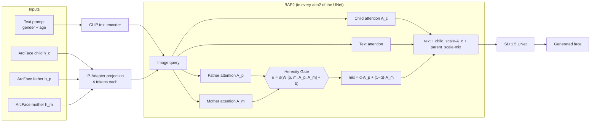
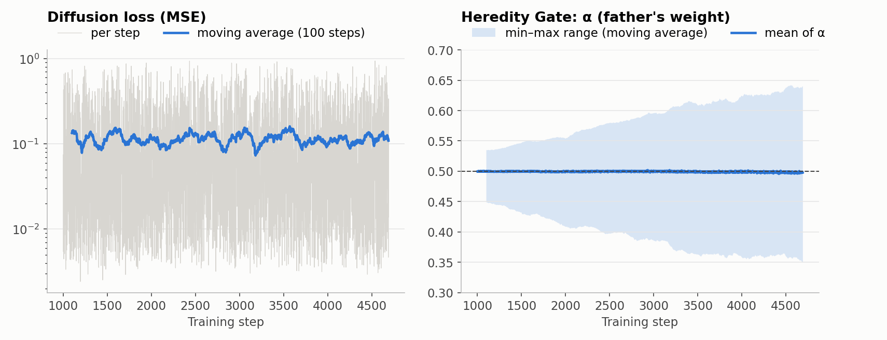
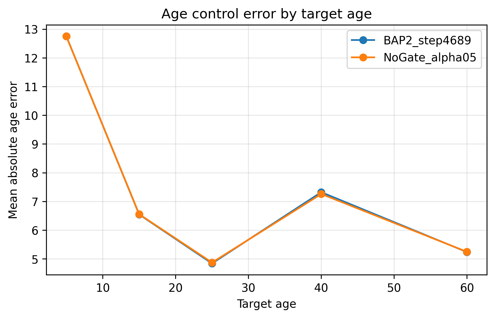

# BAP2: Generating Children's Faces from Their Parents

**Biparental attention with a *Heredity Gate* on top of Stable Diffusion + IP-Adapter-FaceID**

Undergraduate thesis project (Trabajo Terminal II) · B.Eng. in Artificial Intelligence


BAP2 is a custom cross-attention processor for Stable Diffusion 1.5 that generates a face conditioned on
**three identities at once: child, father and mother**. It extends IP-Adapter-FaceID with separate father
and mother attention branches, and blends them with a small learned module, the **Heredity Gate**, which
decides how much each parent contributes (α). Only the gate is trained (≈0.79 M parameters) on 1,563
parent–child triads from the *Families in the Wild* (FIW) dataset.

The repository contains the full pipeline: dataset analysis and family-level splits, ArcFace embedding
validation, age labeling, training, evaluation (FID, age error, identity and kinship similarity), the final
checkpoint, and CPU unit tests.

---

## Contents

- [How it works](#how-it-works)
- [Quick start](#quick-start)
- [Reproduce the project step by step](#reproduce-the-project-step-by-step)
- [Results](#results)
- [Repository layout](#repository-layout)
- [Tests](#tests)
- [Limitations](#limitations)
- [Ethical considerations](#ethical-considerations)
- [License](#license)
- [Citation](#citation)
- [References](#references)

## How it works

Identity adapters such as IP-Adapter-FaceID can generate portraits that keep the identity of **one**
person from their face embedding. This project explores conditioning generation on **both parents at the
same time**, so that the generated child keeps family traits, and *learning* how much each parent
contributes instead of fixing it by hand.

BAP2 (*Biparental Attention Processor v2*) replaces the 16 cross-attention processors (`attn2`) of the
Stable Diffusion 1.5 UNet. Self-attention (`attn1`) is left untouched.



**Per-layer equations:**

```
α          = sigmoid( W · [mean(tokens_p), mean(tokens_m), mean(A_p), mean(A_m)] + b )   # [B, 16 groups]
parent_mix = α · A_p + (1 − α) · A_m
output     = TextAttention + scale · ( child_scale · A_c + parent_scale · parent_mix )
```

Key design decisions:

| Decision | Why |
|---|---|
| Father/mother branches initialized from the IP-Adapter-FaceID `to_k_ip` / `to_v_ip` weights | Start from a projection that already maps ArcFace embeddings to facial attention. |
| Gate initialized to zero, so α = 0.5 | At the start both parents are mixed equally; training only moves away from that if it lowers the loss. |
| One α per **channel group** (16 groups) | Different parts of the representation can inherit from different parents. |
| Gate in `float32`, branches in `float16` | The gate produced NaN in `fp16`; everything else keeps half-precision speed. |
| *Child anchor* (`child_scale = 1.0`, `parent_scale = 0.1`) | The child sets the base identity; the parents add a controllable kinship signal. |
| Only the gate is trained (≈0.79 M parameters) | The UNet, VAE, text encoder and IP-Adapter projection stay frozen. |

Implementation: [`src/bap2.py`](src/bap2.py) (processor) and [`src/att2.py`](src/att2.py) (installation into the UNet).

## Quick start

> Requirements: an NVIDIA GPU (the project was run on Google Colab), Python 3.10+, and access to the
> FIW dataset for the data-dependent steps (see [`data/README.md`](data/README.md)).

```bash
git clone https://github.com/FatyAvilaa/kinship-face-generation-bap2.git
cd kinship-face-generation-bap2
pip install -r requirements.txt
pip install git+https://github.com/tencent-ailab/IP-Adapter.git
```

Generate a child's face with the final model:

```python
from src.notebook_setup import setup_full_generation_context
from src.inference_utils import generate_bap2_image, get_embedding, CHILD_NEGATIVE_PROMPT

ctx = setup_full_generation_context("/path/to/kinship-face-generation-bap2", parent_scale=0.1)

sample = ctx.data.test_ds[0]
emb = ctx.data.embeddings
img, prompt, alpha_stats = generate_bap2_image(
    pipe=ctx.pipe, ip_model=ctx.ip_model,
    h_c=get_embedding(emb, sample["key_c"]),
    h_p=get_embedding(emb, sample["key_p"]),
    h_m=get_embedding(emb, sample["key_m"]),
    gender=sample["gender"], age=10,
    device=ctx.runtime.device, dtype=ctx.runtime.dtype,
    parent_scale=0.1, seed=42,
    child_prompt=True, negative_prompt=CHILD_NEGATIVE_PROMPT,
)
img.save("generated_child.png")
```

Models (Stable Diffusion, VAE, IP-Adapter-FaceID, ArcFace) are downloaded automatically the first time.
More examples in [`docs/USAGE.md`](docs/USAGE.md).

## Reproduce the project step by step

1. **Get the data.** Request FIW, place it in `data/raw/FIDs/`, and check the layout in
   [`data/README.md`](data/README.md). The splits used in the thesis are already in `data/splits/`.
2. **Set up the environment.** Notebooks 01–02 use paths relative to the repository and can run locally.
   Notebooks 03–08 were run on Google Colab: copy this repository to Google Drive (they use
   `/content/drive/MyDrive/Notebook4` by default; change `DRIVE` near the top of each notebook if you use
   another folder) and open them with a GPU runtime.
3. **Run the notebooks in order:**

| # | Notebook | What it does | GPU |
|---|---|---|---|
| 01 | [`01_database_exploration`](notebooks/01_database_exploration.ipynb) | Analyzes FIW (980 families), extracts father–mother–child triads and splits them **by family** 80/10/10 so no identity leaks between splits. | No |
| 02 | [`02_arcface_validation`](notebooks/02_arcface_validation.ipynb) | Extracts ArcFace embeddings (InsightFace `buffalo_l`) and validates them: same person vs. kin vs. non-kin, similarity by relationship type. | Yes |
| 03 | [`03_mivolo_age_estimation`](notebooks/03_mivolo_age_estimation.ipynb) | Labels the age of the 1,967 children with MiVOLO v2 (the age goes into the prompt). | Yes |
| 04 | [`04_bap2_training`](notebooks/04_bap2_training.ipynb) | First training phases of the gate (steps 0 → 1000), visual audit, `parent_scale` sweep and the comparison against the no-gate baseline. | Yes |
| 05 | [`05_bap2_final_training`](notebooks/05_bap2_final_training.ipynb) | Final training (steps 1000 → 4689, 3 epochs), checkpoint selection and the final test on 208 triads × 5 ages. | Yes |
| 06 | [`06_fid_age_metrics`](notebooks/06_fid_age_metrics.ipynb) | Final metrics: FID, age error (E_age) and identity/kinship similarity with paired statistics. | Yes |
| 07 | [`07_qualitative_figures`](notebooks/07_qualitative_figures.ipynb) | Qualitative figures per method and age progression. | Yes |
| 08 | [`08_final_child_figures`](notebooks/08_final_child_figures.ipynb) | Final figures with child prompts for the thesis. | Optional |

> Steps 01–03 can be skipped if you only want to use the final model: the splits, ages and gender labels
> are already included, and you only need to generate the ArcFace embeddings (notebook 02, *GPU
> extraction* cell). Notebooks 04, 05, 07 and 08 are published **without their image outputs**, because
> they contained real FIW faces and faces generated from them. The code and text logs are complete.

### Training setup

| Parameter | Value |
|---|---|
| Base model | `SG161222/Realistic_Vision_V4.0_noVAE` + VAE `stabilityai/sd-vae-ft-mse` |
| Adapter | IP-Adapter-FaceID SD 1.5 (`h94/IP-Adapter-FaceID`) |
| Loss | Noise-prediction MSE (L_diff) |
| Optimizer | AdamW, lr = 1e-4, eps = 1e-6, weight decay = 0, grad clip = 1.0 |
| Batch / steps | 1 / 4,689 (3 epochs over 1,563 triads) |
| Trainable parameters | 792,832 (only the 16 Heredity Gates) |
| Hardware | Google Colab GPU |



The gate slowly moves away from α = 0.5: the spread of α across groups and samples grows
(std 0.009 → 0.030, final range 0.34–0.63), but **the mean stays at ≈ 0.50**.

### Data

- **Dataset:** [Families in the Wild (FIW)](https://web.northeastern.edu/smilelab/fiw/) — 980 families, ~26.5 k faces.
- **Triads:** 1,571 (train) / 196 (val) / 212 (test) unique father–mother–child triads; 1,563 / 208 used after removing missing embeddings.
- **Split:** by family (630 / 79 / 79 families); no family appears in two splits.

## Results

Evaluated on the test set: **208 triads × 5 target ages (5, 15, 25, 40, 60) = 1,040 images per variant**,
with the same seed for every variant.

Compared variants:

- **BAP2 λ=0.0**: child identity only (`parent_scale = 0`), equivalent to IP-Adapter-FaceID.
- **NoGate α=0.5**: both parents with a fixed 50/50 mix (`parent_scale = 0.1`).
- **BAP2 λ=0.1**: proposed model, learned gate (`parent_scale = 0.1`).

### Identity and kinship (ArcFace cosine similarity, mean)

| Variant | S_id child ↑ | S father ↑ | S mother ↑ | S family ↑ |
|---|---:|---:|---:|---:|
| BAP2 λ=0.0 (child only) | 0.1869 | 0.0114 | 0.0171 | 0.0143 |
| NoGate α=0.5 | 0.1866 | 0.0169 | 0.0229 | 0.0199 |
| **BAP2 λ=0.1 (proposed)** | **0.1870** | **0.0171** | **0.0231** | **0.0201** |

### Paired comparison (same triad, age and seed)

| Comparison | Metric | Mean Δ | % of cases where A wins |
|---|---|---:|---:|
| BAP2 λ=0.1 − BAP2 λ=0.0 | S family | +0.0058 | **71.9 %** |
| BAP2 λ=0.1 − BAP2 λ=0.0 | S id child | +0.00002 | 49.2 % |
| BAP2 λ=0.1 − NoGate α=0.5 | S family | +0.0002 | 53.0 % |
| BAP2 λ=0.1 − NoGate α=0.5 | S id child | +0.0004 | 53.2 % |

### Image quality and age control

| Variant | FID ↓ (n = 208) | E_age ↓ (years, mean ± std) |
|---|---:|---:|
| BAP2 λ=0.0 | 193.68 | — |
| NoGate α=0.5 | 192.88 | 7.33 ± 6.44 |
| BAP2 λ=0.1 | 193.03 | 7.34 ± 6.43 |

- **FID:** real child images vs. images generated at the child's estimated real age (target ages are not mixed).
- **E_age:** |estimated age (DEX) − prompt target age| over the multi-age images.



### Conclusions

1. **The parent branches do transfer family resemblance.** Turning the parents on (λ = 0.1) raises the
   similarity to the family in 72 % of the paired cases, **without hurting** the child's identity, FID or
   age control.
2. **The learned gate does not beat the fixed 50/50 mix.** With the diffusion loss as the only signal, α
   converges around 0.5 and BAP2 is practically tied with NoGate (Δ ≈ 0.0002). The reconstruction loss has
   no explicit signal about *which* parent to inherit from, so the gate has no incentive to learn large
   asymmetries.
3. **Age control works better for adults** (E_age ≈ 4.8 years at 25) than for young children (≈ 12.8 years
   at 5): the base model tends to make children look older.

The full CSVs are in [`results/eval/`](results/eval/).

### ArcFace embedding validation (notebook 02)

Before training, we checked that ArcFace captures kinship in FIW:

| Case | Mean cosine similarity |
|---|---:|
| Same person (split-half) | 0.90 |
| Kin (father/mother–child) | 0.24 |
| Non-kin | 0.12 |

Kin vs. non-kin AUC = **0.789** (Mann-Whitney p = 4.2 × 10⁻³³).


## Repository layout

```
├── src/                         # Model code and utilities
│   ├── bap2.py                  # BAP2 attention processor + Heredity Gate
│   ├── att2.py                  # Installs BAP2 into the UNet (copies IP-Adapter weights)
│   ├── dataset.py               # FIW triad dataset (embeddings + image + age + gender)
│   ├── data_utils.py            # Embedding loading, splits and DataLoaders
│   ├── model_utils.py           # Loads SD 1.5, IP-Adapter-FaceID, ArcFace and the BAP2 checkpoint
│   ├── inference_utils.py       # Prompts and generation with BAP2
│   ├── image_utils.py           # Image helpers
│   ├── config.py                # Project paths and device
│   └── notebook_setup.py        # One-line setup for the notebooks
├── notebooks/                   # Full pipeline (01 → 08)
├── tests/                       # CPU unit tests (pytest)
├── data/
│   ├── splits/                  # Triads and families per split (paths relative to FIW)
│   ├── ages/mivolo_ages.csv     # Estimated age of each child
│   └── gender_dict.pkl          # Gender per person (key FXXXX/MIDY)
├── results/
│   ├── ckpt/bap2_4689/          # Final gate checkpoint (3.8 MB) + training logs
│   ├── eval/                    # Metric tables (CSV)
│   └── figures/                 # Plots
├── docs/USAGE.md                # Code usage guide
├── LICENSE                      # MIT (code)
├── THIRD_PARTY_LICENSES.md      # Licenses of data, models, checkpoint and dependencies
└── CITATION.cff                 # How to cite this work
```

## Tests

The tests run on CPU in a few seconds and do not download any model (they use a diffusers `Attention`
layer and a tiny UNet):

```bash
pip install torch "diffusers==0.27.2" "huggingface_hub==0.23.0" pytest
pytest -q
```

They check: output shape, initial α = 0.5, that `parent_scale = 0` ignores the parents, father/mother
symmetry at initialization, that only the gate receives gradients, that only `attn2` is replaced, and that
the checkpoint keys match the processor names.

## Limitations

- **Training signal:** the diffusion loss does not explicitly reward resemblance to each parent. An
  identity loss on the parents (e.g. ArcFace similarity of the predicted image) could let the gate learn
  asymmetric inheritance.
- **FID on 208 images** has high variance; differences under 1 point between variants are not significant.
- **Dataset bias:** FIW is mostly made of families of public figures; its distribution of ages,
  ethnicities and photo conditions is not representative.
- **Young children:** the base model makes young children look older; a child-specific prompt or
  fine-tuning would help.

## Ethical considerations

- This is an **academic** project. The generated faces are synthetic and are **not** a reliable prediction
  of what a real child looks like; they must not be used to infer kinship or identity of real people.
- FIW is distributed under its own research terms and is **not included** in this repository. No face
  images (real or generated from real faces) are published either.

## License

- **Code** (`src/`, `tests/`, notebook code): [MIT](LICENSE).
- **Documentation, figures and metric tables:** [CC BY 4.0](https://creativecommons.org/licenses/by/4.0/).
- **Trained gate checkpoint and split metadata:** non-commercial research use only, because they derive
  from FIW, IP-Adapter-FaceID and InsightFace models, which carry that restriction.

FIW, Stable Diffusion, IP-Adapter, InsightFace, MiVOLO and DEX keep their original licenses. Details in
[`THIRD_PARTY_LICENSES.md`](THIRD_PARTY_LICENSES.md).

## Citation

If you use this work, please cite it (GitHub also shows a *Cite this repository* button from
[`CITATION.cff`](CITATION.cff)):

```bibtex
@software{avila2026bap2,
  author = {Avila, Fatima},
  title  = {{BAP2}: Biparental Attention with a Heredity Gate for Generating Children's Faces from Their Parents},
  year   = {2026},
  url    = {https://github.com/FatyAvilaa/kinship-face-generation-bap2}
}
```

## References

- Robinson, J. P. et al. *Families in the Wild (FIW): Large-Scale Kinship Image Database and Benchmarks.* ACM MM 2016.
- Ye, H. et al. *IP-Adapter: Text Compatible Image Prompt Adapter for Text-to-Image Diffusion Models.* 2023.
- Rombach, R. et al. *High-Resolution Image Synthesis with Latent Diffusion Models.* CVPR 2022.
- Deng, J. et al. *ArcFace: Additive Angular Margin Loss for Deep Face Recognition.* CVPR 2019.
- Kuprashevich, M. & Tolstykh, I. *MiVOLO: Multi-input Transformer for Age and Gender Estimation.* 2023.
- Rothe, R. et al. *DEX: Deep EXpectation of Apparent Age from a Single Image.* ICCV Workshops 2015.
- Heusel, M. et al. *GANs Trained by a Two Time-Scale Update Rule Converge to a Local Nash Equilibrium* (FID). NeurIPS 2017.

## Author

Developed by [@FatyAvilaa](https://github.com/FatyAvilaa) as the undergraduate thesis (Trabajo Terminal II)
of the B.Eng. in Artificial Intelligence.
